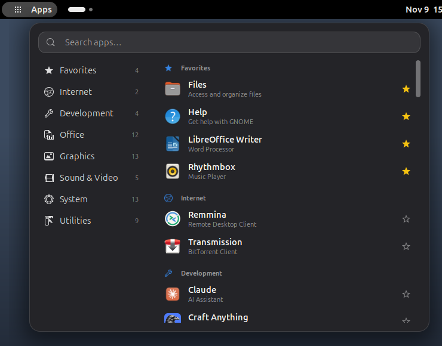
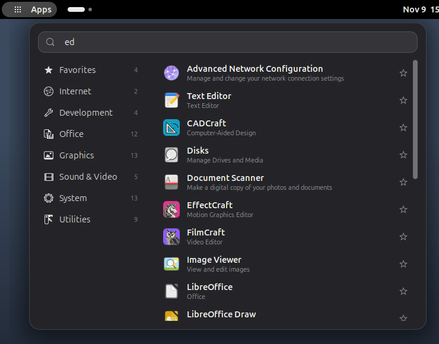
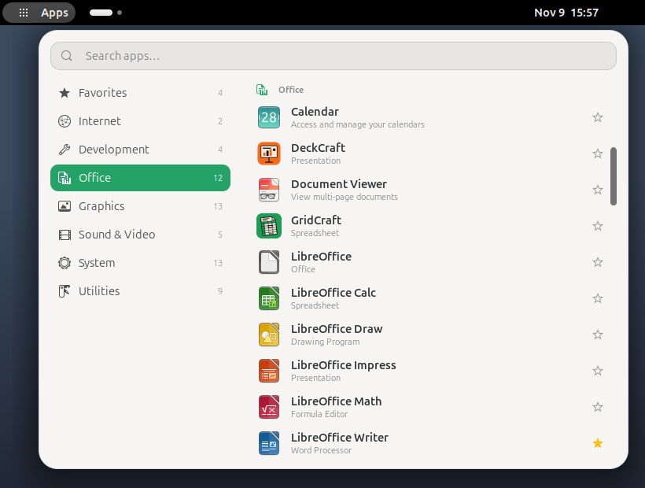
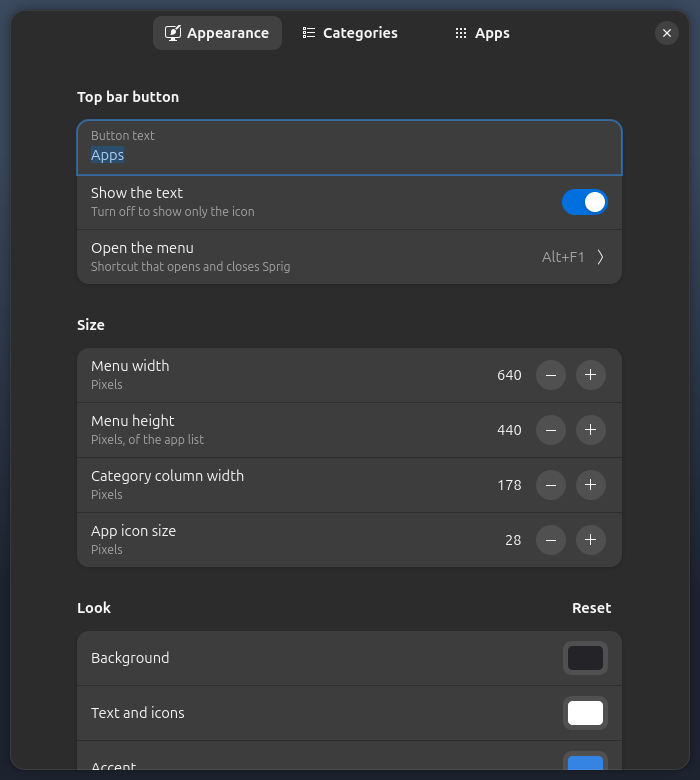

# Sprig

*Part of the Sedge family of webhookstudios apps.*

A top-left app menu for GNOME. Your apps are grouped by category, searchable, and easy to launch, with settings for colors, size, categories and hidden apps.



| Search | Your own colors and size |
|---|---|
|  |  |



## Requirements

- GNOME Shell 50 (Ubuntu 26.04)
- A Wayland session, which is the Ubuntu default

Sprig has only been tested on Ubuntu 26.04 with GNOME Shell 50.1 on Wayland.

## Install

### With the deb package (recommended)

Download `sprig_1.1.1_all.deb` from the [latest release](https://github.com/webhookstudios/sprig/releases/latest), then install it:

```bash
sudo apt install ./sprig_1.1.1_all.deb
```

Log out and back in, then open **Sprig** from the apps menu. The first time, that turns Sprig on and opens its settings.

To remove it:

```bash
sudo apt remove sprig
```

### As an extension zip, without root

```bash
wget https://github.com/webhookstudios/sprig/releases/latest/download/sprig@webhookstudios.github.io.shell-extension.zip
```

```bash
gnome-extensions install --force sprig@webhookstudios.github.io.shell-extension.zip
```

Log out and back in, then:

```bash
gnome-extensions enable sprig@webhookstudios.github.io
```

### From source

```bash
git clone https://github.com/webhookstudios/sprig.git
```

```bash
./sprig/install.sh
```

## Using it

Click **Apps** at the top left, or press <kbd>Alt</kbd>+<kbd>F1</kbd>.

- Type to search. <kbd>Enter</kbd> launches the first result, <kbd>Esc</kbd> clears the search.
- Click a category on the left to jump to it. Inside each category, apps are alphabetical.
- Click the star next to an app to add it to Favorites. These are the same favorites as your dock.

## Settings

Open **Sprig** from the apps menu, or run:

```bash
gnome-extensions prefs sprig@webhookstudios.github.io
```

| Page | What you can change |
|---|---|
| Appearance | Button text and shortcut, menu width and height, category column width, icon size, background, text and accent colors, opacity, corner radius, descriptions |
| Categories | Hide any category, add your own categories, reset manual choices |
| Apps | Hide any app, or move it to a different category, built-in or your own |

Changes apply to the open menu straight away.

## Development

```bash
ln -s "$PWD/sprig@webhookstudios.github.io" ~/.local/share/gnome-shell/extensions/
```

```bash
glib-compile-schemas sprig@webhookstudios.github.io/schemas
```

A Wayland session cannot reload extension code, so each change needs a logout. Build the release files into `dist/` with `./pack.sh` (extension zip) and `./build-deb.sh` (deb package, needs only `dpkg-deb`).

| File | Purpose |
|---|---|
| `extension.js` | The top bar button and the menu |
| `groups.js` | Category definitions shared with the settings window |
| `prefs.js` | The settings window |

## License

GPL-2.0-or-later. See [LICENSE](LICENSE).
